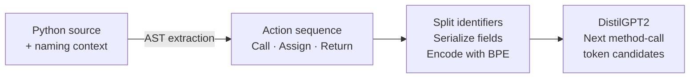

# Next method call prediction with Python action sequences

Research materials for **Represent Code as Action Sequence for Predicting Next Method Call**, Internetware 2022.

[中文](README.zh-CN.md) · [Paper (DOI)](https://doi.org/10.1145/3545258.3545263) · [Paper draft](Represent_Code_as_Action_Sequence_for_Predicting_Next_Method_Call_draft.pdf) · [Slides](<slides_internetware_2022_Represent Code as Action Sequence for Predicting Next Method Call.pdf>)

This work studies whether a structured sequence of Python operations helps a language model predict the next method-call token. It represents calls, assignments, and returns as actions with context, an actor, a call, and parameters. The task is narrower than completing an entire statement or predicting an arbitrary code edit.

The repository contains the paper, presentation, and an early implementation of action extraction and preprocessing. A small extraction demo runs with Python's standard library. The original training pipeline, dataset splits, and trained weights are not included.

## From Python code to a prediction

```python
def save_data(output_file, rows):
    target_file = open(output_file, "w")
    target_file.write(rows)
    target_file.close()
```

The extractor produces operations such as:

| Function context | Type | Actor | Call | Parameters |
| --- | --- | --- | --- | --- |
| `save_data` | Call | `$` (global) | `open` | `output_file`, `$Const$` |
| `save_data` | Assign | `target_file` | — | — |
| `save_data` | Call | `target_file` | `write` | `rows` |
| `save_data` | Call | `target_file` | `close` | — |

Names and the preceding extracted operations are the model's inputs. Section 6.2 of the paper specifies DistilGPT2; slide 20 describes the prediction target as the first word of a method call. The released files do not include the evaluator needed to verify how that word is matched to BPE tokens; see the [metric definitions](docs/reproducibility.md#metric-and-length-definitions).

Here, **actions are extracted from source code using an AST**. They are an approximation of programming activity, not recorded keystrokes, cursor movements, or actual execution traces. The [representation guide](docs/representation.md) explains the raw format and where the implementation differs from the paper.



*Method overview: source and naming context become structured actions, which are encoded for language modeling. At prediction time, the model receives the token prefix preceding the target. See paper Figures 3–5 and Section 6.2.*

## Why revisit this work today?

The useful research question is whether explicit action structure improves a modern model's quality or efficiency **when the input information and token budget are controlled**. That benefit has not been established by the 2022 experiments for today's models.

Recent work supplies more realistic settings for testing related hypotheses: [EditFlow (2026)](https://arxiv.org/abs/2602.21697v3) evaluates reconstructed editing flows, while [DECODE (September 2026 revision)](https://arxiv.org/abs/2607.25130v2) studies real developer edits of accepted AI completions. Industry work such as [Zeta2.1](https://zed.dev/blog/zeta2-1) shows that changing an edit model's output format can reduce generated tokens and latency. These are reasons to investigate representation and context selection; they do not demonstrate adoption or superiority of this paper's action format. See [current research questions and evidence](docs/research-context.md), reviewed on 2026-10-19.

## Try action extraction

From the repository root, run:

```sh
python sample/extract_actions.py
```

Or inspect a Python source file:

```sh
python sample/extract_actions.py path/to/file.py
```

The command parses the file without executing it and prints JSON from the original `CallExtractor`. No model download, GPU, or third-party package is needed for this demo. It has been checked with Python 3.8 and 3.12; the selected interpreter determines which Python syntax can be parsed.

The default input is [sample/py_demo.py](sample/py_demo.py). It illustrates database and file operations; its placeholder database functions are not meant to be executed. The demo stops at raw extraction, before identifier splitting or model prediction.

## Choose a reading path

| Your goal | Start here |
| --- | --- |
| Understand the idea and output | Run the demo, then read the [representation guide](docs/representation.md) |
| Study the original research | Read the [paper draft](Represent_Code_as_Action_Sequence_for_Predicting_Next_Method_Call_draft.pdf) alongside the [experiment and reproducibility notes](docs/reproducibility.md) |
| Explore relevance to current code assistants | Read [research context and open questions](docs/research-context.md) |
| Improve the artifact | See [contributing](CONTRIBUTING.md) for focused starting points |

## What is available?

| Material or capability | Status |
| --- | --- |
| Paper draft and conference slides | Included |
| Single-file AST action extraction | Runnable with the demo above |
| Batch extraction and identifier splitting | Source provided; [execution requirements and known issues](docs/reproducibility.md#batch-preprocessing-requirements-and-known-issues) |
| Original data manifest, dataset splits, training/evaluation scripts, model weights | Not included |
| IDE integration or live next-edit prediction | Not included |

See [reproducibility](docs/reproducibility.md) for runtime requirements, reported experiments, and available research resources.

## How to read the reported result

The draft's abstract reports **81.92% Top-5 accuracy**, compared with **61.89%** for its baseline: a gain of **20.03 percentage points**, or **32.36% relative**. Table 5 instead reports **81.93%** at an 8-action window and context limit 7; paired with the same baseline, that gives **20.04 percentage points**, or **32.38% relative**. The released material does not resolve the 0.01-percentage-point discrepancy.

The baseline uses the same pretrained model according to Section 7.2, with a different AST-derived input format illustrated in Figure 6. These historical token-prediction results do not measure complete-call correctness, executable code, user acceptance, or performance against current code assistants. [Experiment notes](docs/reproducibility.md#reported-experiment) give the full table, source locations, units, and evaluation limits. The extraction demo does not reproduce these model results.

## Repository map

```text
README.md / README.zh-CN.md   English and Chinese entry points
docs/                        Representation, reproducibility, research context
sample/extract_actions.py    Standard-library extraction CLI
sample/py_demo.py            Illustrative source input
src/analysis/                AST extractor and preprocessing source
CONTRIBUTING.md              Ways to contribute
CITATION.cff                 Machine-readable citation
*.pdf                       Paper draft and conference slides
```

In particular, `src/analysis/model.py` defines the action data container and constants; it is not a neural model implementation. The [source map](docs/representation.md#source-map) describes each script.

## Citation

Yu Jiang, Liang Wang, Hao Hu, and Xianping Tao. 2022. *Represent Code as Action Sequence for Predicting Next Method Call*. Internetware 2022, 45–54. [doi:10.1145/3545258.3545263](https://doi.org/10.1145/3545258.3545263).

```bibtex
@inproceedings{jiang2022action,
  author    = {Yu Jiang and Liang Wang and Hao Hu and Xianping Tao},
  title     = {Represent Code as Action Sequence for Predicting Next Method Call},
  booktitle = {Proceedings of the 13th Asia-Pacific Symposium on Internetware},
  year      = {2022},
  pages     = {45--54},
  doi       = {10.1145/3545258.3545263}
}
```

## License

This repository currently has no license file. Please clarify reuse terms with the repository owner before redistributing or incorporating the code. The paper and slides may have separate rights.
