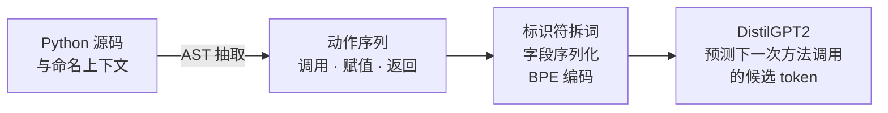

# 用 Python 动作序列预测下一次方法调用

Internetware 2022 论文 **Represent Code as Action Sequence for Predicting Next Method Call** 的研究材料与原型代码。

[English](README.md) · [论文 DOI](https://doi.org/10.1145/3545258.3545263) · [论文草稿](Represent_Code_as_Action_Sequence_for_Predicting_Next_Method_Call_draft.pdf) · [会议幻灯片](<slides_internetware_2022_Represent Code as Action Sequence for Predicting Next Method Call.pdf>)

这项工作研究：将 Python 中的调用、赋值和返回语句表示为结构化动作序列，能否帮助语言模型预测下一次方法调用的 token？每个动作包含上下文、主体、调用和参数。研究任务的范围小于完整语句补全或任意代码编辑预测。

仓库提供论文、演示稿和早期抽取、预处理代码。抽取示例只依赖 Python 标准库，可用于查看原抽取器的输出；原始训练流程、数据划分和模型权重尚未包含在仓库中。

## 从 Python 代码到调用预测

```python
def save_data(output_file, rows):
    target_file = open(output_file, "w")
    target_file.write(rows)
    target_file.close()
```

抽取器会把它表示为如下操作：

| 函数上下文 | 类型 | 主体 | 调用 | 参数 |
| --- | --- | --- | --- | --- |
| `save_data` | Call | `$`（全局） | `open` | `output_file`、`$Const$` |
| `save_data` | Assign | `target_file` | — | — |
| `save_data` | Call | `target_file` | `write` | `rows` |
| `save_data` | Call | `target_file` | `close` | — |

函数名、对象名和先前抽取的操作是模型的输入。论文第 6.2 节指定使用 DistilGPT2；演示稿第 20 页将预测目标称为“方法调用首词”。仓库未提供评估代码，无法独立核验首词与 BPE token 的匹配规则，详见[指标与长度定义](docs/reproducibility.md#metric-and-length-definitions)。

这里的 **human action 指从静态源码中抽取的动作近似**，没有直接记录开发者的键盘、光标或真实运行轨迹。它与今天的下一步编辑预测有共同的问题意识，但任务、数据与评估粒度不同。



*论文方法概览：源码和命名上下文被表示为结构化动作，再编码为语言模型的输入。预测时，模型使用目标之前的 token 前缀。对应论文图 3–5 与第 6.2 节。*

## 在当前研究与工业背景下有什么意义？

值得重新检验的问题是：**在输入信息和 token 预算可比时，显式动作结构能否改善现代模型的预测质量或效率？** 原论文没有验证这一表示对当代模型的收益。

近期工作提供了更贴近实际编辑过程的研究条件：[EditFlow（2026）](https://arxiv.org/abs/2602.21697v3)评估重建的编辑流程；[DECODE（2026 年 9 月修订）](https://arxiv.org/abs/2607.25130v2)研究开发者对已接受 AI 补全的真实修改。工业界的 [Zeta2.1](https://zed.dev/blog/zeta2-1) 则报告，通过改变编辑输出格式减少生成 token 和延迟。这些进展支持继续研究表示与上下文选择，但不构成本文动作格式已被采用或具有当代性能优势的证据。

截至 2026-10-19 核查的资料、任务区别和具体实验建议见[当代背景与研究问题](docs/research-context.md)。

## 快速体验

在仓库根目录运行：

```sh
python sample/extract_actions.py
```

也可以指定自己的 Python 文件：

```sh
python sample/extract_actions.py path/to/file.py
```

命令只解析源码，不执行被解析的程序，并以 JSON 打印原 `CallExtractor` 的输出。无需下载模型、安装第三方依赖或使用 GPU。示例已在 Python 3.8 和 3.12 下检查；可解析的语法由所用解释器决定。

默认输入是 [sample/py_demo.py](sample/py_demo.py)。其中数据库函数是说明用的占位实现，不是可直接运行的数据库示例。这个命令展示原始动作抽取，不包含拆词、训练或预测。

## 按目的阅读

以下详细指南使用英文，便于社区共同维护。

| 你想了解什么 | 阅读入口 |
| --- | --- |
| 动作表示、输出格式与源码职责 | [表示与源码指南](docs/representation.md) |
| 原论文实验，以及目前能复现到哪一步 | [复现说明](docs/reproducibility.md) |
| 与当代代码补全、编辑预测研究的联系 | [研究背景与开放问题](docs/research-context.md) |
| 如何贡献修复、文档或新实验 | [贡献指南](CONTRIBUTING.md) |

## 仓库范围

| 内容 | 状态 |
| --- | --- |
| 论文草稿、会议演示稿 | 已包含 |
| 单文件 AST 动作抽取 | 可通过上面的示例运行 |
| 批量抽取、标识符拆词 | 提供源码；[运行条件与已知问题](docs/reproducibility.md#batch-preprocessing-requirements-and-known-issues)见复现说明 |
| 原始数据清单、数据划分、训练和评估脚本、模型权重 | 未包含 |
| IDE 集成、实时下一步编辑预测 | 未包含 |

`src/analysis/model.py` 定义的是动作数据容器与常量，不是神经网络模型。论文与演示稿保留在根目录，详细说明放在 `docs/`，可运行入口放在 `sample/`。

## 如何理解论文结果

草稿摘要报告 Top-5 准确率从基线的 **61.89%** 提高到 **81.92%**：绝对提高 **20.03 个百分点**，相对提高 **32.36%**。表 5 在动作窗口为 8、上下文长度上限为 7 时给出的数值是 **81.93%**；对应同一基线，绝对提高 **20.04 个百分点**，相对提高 **32.38%**。公开材料没有解释这 **0.01 个百分点**的差异。

第 7.2 节说明比较使用同一预训练模型；基线采用不同的、由 AST 得到的输入格式，图 6 给出了样例。方法调用 token 的命中不等同于完整 API 名、完整调用表达式、可执行代码或用户接受率。这些结果没有与当代代码助手比较。抽取示例仅展示原始动作，不包含模型训练与评估。完整数据表、来源位置、单位和数据划分见[实验与复现说明](docs/reproducibility.md)。

## 引用与许可

Yu Jiang, Liang Wang, Hao Hu, Xianping Tao. 2022. *Represent Code as Action Sequence for Predicting Next Method Call*. Internetware 2022, 45–54. [DOI](https://doi.org/10.1145/3545258.3545263)。BibTeX 见[英文 README](README.md#citation)，机器可读信息见 [CITATION.cff](CITATION.cff)。

仓库目前没有许可证文件。如需再分发或将代码纳入其他项目，请先与仓库所有者明确使用条款；论文和幻灯片可能适用独立的权利条款。
