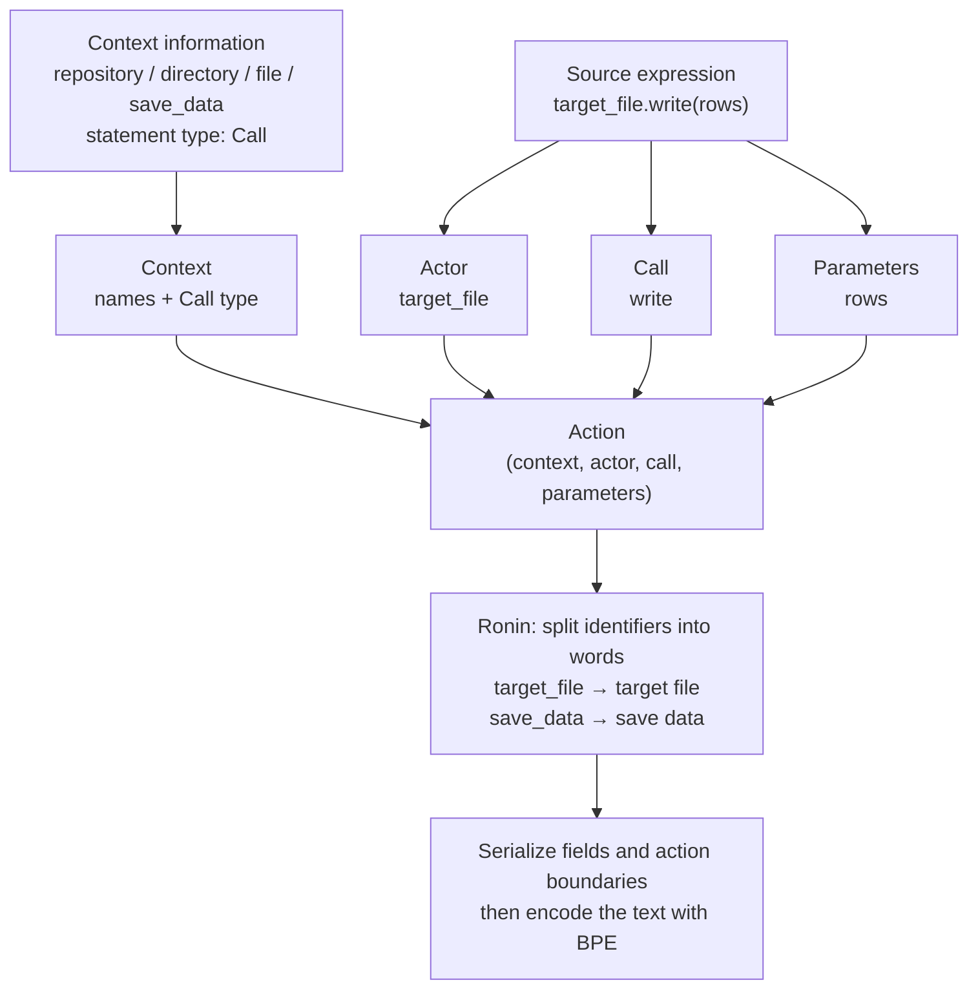
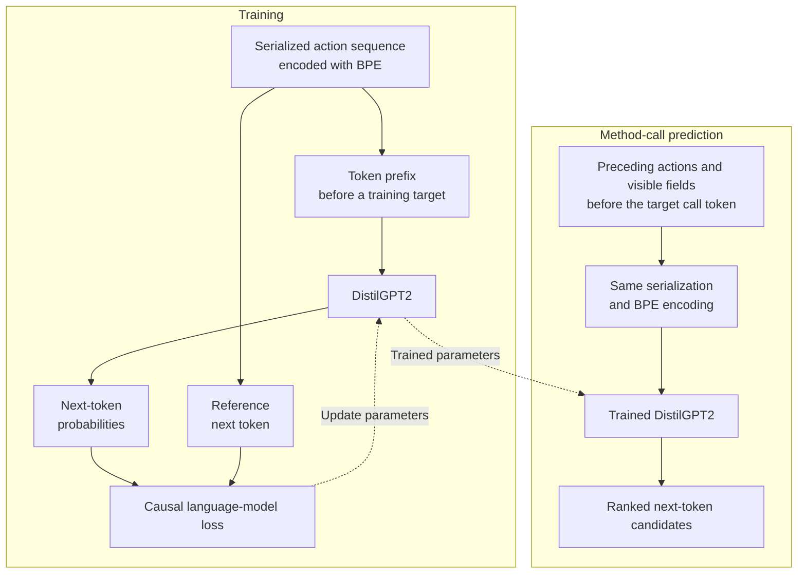

# Action representation: from Python source to model input

[Home](../README.md) · [Reproducibility](reproducibility.md) · [Research context](research-context.md)

This guide connects the paper's representation to the output of the public extractor. Start with `python sample/extract_actions.py` from the repository root.

## The paper's representation

Section 4 of the [paper draft](../Represent_Code_as_Action_Sequence_for_Predicting_Next_Method_Call_draft.pdf) defines an action as:

```text
action = (context, actor, call, parameters)
context = (repository, directory, file, method, statement type)
```

For a call, the actor is the receiver, such as `target_file` in `target_file.write(rows)`. Calls without an explicit receiver use a global marker. Naming context identifies the repository, directory, file, and enclosing function; statement type distinguishes calls, assignments, and returns.

Figure 3 of the paper connects source code and its surrounding names to these fields. For the call `target_file.write(rows)` inside `save_data`, the representation has the following structure:



*Field mapping follows Section 4.1 and Figure 3. Ronin word splitting precedes BPE encoding; an identifier word may become more than one model token. The raw extractor's narrower context is described below.*

## From an action sequence to a prediction

The model learns from serialized action sequences. Figure 4 shows causal next-token training: each prediction uses only the preceding token prefix, and the reference next token supplies the training target. Section 6.2 specifies DistilGPT2.



*Training follows Figure 4; the prediction prefix follows the example in Figure 6. Solid arrows carry data; dashed arrows show parameter updates or reuse. The reference target supervises training and is not part of the model's input prefix.*

In Figure 6, a four-action window contains three preceding calls and the visible prefix of the target call. The model predicts at that token position; it does not generate an entire four-action sequence as one prediction. The paper reports Top-5 accuracy for a method-call token, described as the first word in the slides. See [metric and length definitions](reproducibility.md#metric-and-length-definitions) for the distinction between actions, words, and BPE tokens.

The [extraction demo](../README.md#try-action-extraction) exposes the raw AST actions. See the [reproducibility guide](reproducibility.md) for executable scope and experiment resources.

## Read the actual output

For this input:

```python
def f():
    rows = database.execute(query).get()
```

`CallExtractor` produces this JSON, shown compactly:

```json
[
  "*f",
  [["f"], "<Call>", "database", "execute", ["query"]],
  [["f"], "<Call>", "database.execute", "get", []],
  [["f"], "<Assign>", ["rows"]],
  "#f"
]
```

Function boundaries are strings. `*f` begins a function and `#f` ends it; nested functions use repeated markers, such as `**inner` and `##inner`. Action records are lists:

| Record | Meaning |
| --- | --- |
| `[function_stack, "<Call>", actor, call, parameters]` | A call with a receiver and simplified positional arguments |
| `[function_stack, "<Assign>", targets]` | An ordinary assignment, retaining supported left-hand targets |
| `[function_stack, "<Return>"]` | A return statement; its expression is not retained in this record |

Calls within a return expression are visited separately before the return record. The raw context is the stack of enclosing synchronous function names, not the full repository/directory/file context described in the paper. Here “method” follows the paper's terminology; the visitor also processes ordinary module-level `def` functions.

Special values include `$` for a global call and `$Const$` for a retained literal. Literal values are collapsed, `None` is skipped, and argument names are simplified. This representation cannot reconstruct the original source.

## Order and scope matter

The extractor visits child AST nodes before recording a call, assignment, or return. In the example above, `execute` precedes `get`, followed by assignment to `rows`. Figure 3 of the draft puts assignment before its right-hand-side calls. Preserve this distinction when implementing a model input or defining a prediction point.

For an assignment, the extractor retains the left-hand target as the actor, consistent with Section 4.1.2 and Figure 3. Equation 4 instead writes `Global` in that position. This discrepancy in the draft remains unresolved; the output example above reflects the released extractor.

AST traversal also includes both sides of conditionals and code after a return. It does not establish execution paths or the order in which a developer typed the program. Function defaults and decorators can appear in the sequence without following their runtime order.

Known limits of the current extractor include:

| Python construct | Current behavior |
| --- | --- |
| `async def` | Calls are visited, but no async function boundary or name is added |
| Class methods | Class names are not added to context |
| Keyword arguments | Not included in the parameter list |
| `config.name` as an argument | Retains `name`, losing the receiver |
| `x: int = build()` or `x += increment()` | Visits the call, but emits no assignment record |
| `a, b = pair()` | Emits an assignment with an empty target list |
| `handlers[0].run()` | Misidentifies the receiver and leaves the call field empty |
| `factory()()` | Records the inner call but omits the outer call |

These behaviors make the extractor useful for inspecting the proposed abstraction, but insufficient as a general Python semantic analyzer. Changes to them should include a small input/output example and a clear statement of how the representation changes.

## From raw actions to fields

The preprocessing source uses `data_utils.extract_by_method` to group records, then converts them into `Quad` objects. `Quad` has five attributes: `ctx`, `type`, `actor`, `call`, and `paras`. This separates statement type from context in storage even though the paper includes it in the context definition.

The converter prepends a file basename without `.py` to the function stack. It does not add repository or directory names. `quads_split.py` splits identifiers with Ronin and applies storage limits to the resulting lists: context 7 elements, call 7, a single ordinary actor identifier 3, and call parameters 3. Special actor markers bypass splitting; the multiple-actor branch does not apply the same actor limit. These are pre-BPE storage limits, not the number of model tokens or a complete specification of the training configuration.

The splitter's `key` is only the last function name. It is not a unique identity across files, classes, or repositories. Dataset builders need stable sample IDs and explicit prediction locations.

For batch processing, see [runtime requirements and known issues](reproducibility.md#batch-preprocessing-requirements-and-known-issues).

## Source map

| File | Responsibility |
| --- | --- |
| [sample/extract_actions.py](../sample/extract_actions.py) | Command-line wrapper: read Python source, parse it, and print raw actions |
| [sample/py_demo.py](../sample/py_demo.py) | Illustrative database/file-operation input, intended for static parsing |
| [call_extractor.py](../src/analysis/call_extractor.py) | `CallExtractor`, function boundary markers, and older sequence helpers |
| [model.py](../src/analysis/model.py) | `Quad` data container, special markers, and field limits; no neural network |
| [history_extractor.py](../src/analysis/history_extractor.py) | Batch source-file processing; despite its name, does not collect Git or IDE edit history |
| [data_utils.py](../src/analysis/data_utils.py) | Method grouping and conversion from raw lists to `Quad` objects |
| [quads_split.py](../src/analysis/quads_split.py) | Ronin identifier splitting and pickle input/output |
| [utils.py](../src/analysis/utils.py) | Numeric count parsing for batch work |
| [astpp.py](../src/analysis/astpp.py) | AST inspection helper with attribution to Green Tree Snakes |

The CLI invokes the original visitor through `visit_and_save`, with a fresh instance for each invocation. Optional Ronin imports in `call_extractor.py` are loaded only when its splitting helpers are called. The CLI performs no identifier splitting and does not import the historical batch pipeline.
