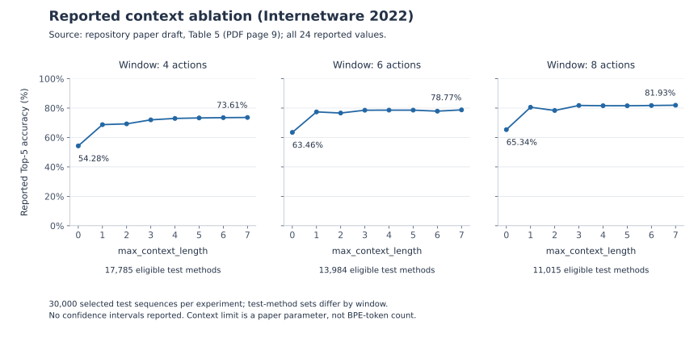

# Reported results, metric definitions, and reproduction status

[Home](../README.md) · [Representation](representation.md) · [Research context](research-context.md)

The public artifact supports inspecting and running raw action extraction. Reproducing the paper's model results requires additional resources and implementation work. This page distinguishes reported experiments from the executable material in the repository.

The extraction and preprocessing behavior described here is based on commit [`c1fcc1b`](https://github.com/JY0284/code_completion_as_human_action_prediction/tree/c1fcc1be9c4c7eae06cde61bd9ba8b262a96455a). The demo uses the same AST visitor. Identifier-splitting dependencies are loaded only by the splitting helpers, so raw extraction requires only the Python standard library.

## Runnable scope

From the repository root:

```sh
python sample/extract_actions.py
python sample/extract_actions.py sample/py_demo.py
python sample/extract_actions.py --help
```

The CLI has been checked with Python 3.8 and 3.12. It uses only the standard library, honors source encoding declarations, and parses rather than executes the input. An unreadable file or syntax error produces a diagnostic and a nonzero exit status. Valid syntax may still contain constructs that the historical visitor handles incompletely; see the [representation limits](representation.md#order-and-scope-matter).

This verifies a source-to-actions path. It does not verify identifier splitting, dataset construction, training, or prediction accuracy.

## Reported experiment

The technical source is the repository's 10-page [paper draft](../Represent_Code_as_Action_Sequence_for_Predicting_Next_Method_Call_draft.pdf), supplemented by the 25-page [conference slides](<../slides_internetware_2022_Represent Code as Action Sequence for Predicting Next Method Call.pdf>). Page references below count PDF pages from 1. The draft contains publication-metadata placeholders; the final publisher PDF has not been checked against it. The title, authors, venue, and pages are corroborated by the [author's publication list](https://cs.nju.edu.cn/wangliang/publications.html); use the [published DOI](https://doi.org/10.1145/3545258.3545263) for citation.

| Item | Reported setup | Source |
| --- | --- | --- |
| Task | Next-method-call token prediction; slides call the target the method call's first word | Draft p. 1; slides p. 20 |
| Model | DistilGPT2; causal language modeling of serialized actions | Section 6.2, pp. 6–7 |
| Data source | CodeSearchNet-derived repository collection, extended with GitHub file structures and source files; a separately constructed dataset | Section 5.1.2, p. 5 |
| Filtering | Exclude files with more than 500 lines and methods yielding fewer than 3 actions | Section 6.1.2, p. 6 |
| Training methods | 311,801 in each listed setting | Table 3, p. 6 |
| Test methods | 17,785 / 13,984 / 11,015 for windows 4 / 6 / 8, respectively | Table 3, p. 6 |
| Selected test sequences | 30,000 per experiment; the sampling algorithm and seed are not supplied | Section 6.1.2, p. 6 |
| Training action window | `window_size = -1`: no action-count limit at this preprocessing step; not unlimited model context | Table 4, p. 7 |
| Test action window | `window_size` = 4, 6, or 8 | Figure 7 and Table 5, pp. 7 and 9 |
| Context ablation | `max_context_length` = 0, 1, 2, 3, 4, 5, 6, or 7 | Table 4, p. 7 |

Table 2 (p. 6) reports the corpus overview below. These are not the sizes of the final training split:

| Corpus quantity | Reported count |
| --- | ---: |
| Repositories | 13,006 |
| Source code files | 441,290 |
| Methods | 3,550,572 |
| Lines | 85,238,675 |
| Tokens, using Table 2's label | 73,335,634 |
| Unique tokens, using Table 2's label | 175,143 |

Table 2 does not specify a counting procedure that establishes whether its token counts are before or after BPE. They must not be used as a verified language-model training-token budget. In these tables, “methods” follows the paper's terminology for Python functions/methods; it is not a count of method-call expressions or developers.

### Metric and length definitions

| Term | Definition used in this documentation | Limit of verification |
| --- | --- | --- |
| Top-5 accuracy (%) | Percentage of evaluated prediction targets whose reference answer is among the five highest-ranked candidates | The paper reports this metric, but the evaluator and candidate-normalization rules are absent |
| Prediction target | The draft says “next method call token”; slides p. 20 say “method call first word” | Figure 6 shows `ordered_dict` split into `ordered dict`, with `ordered` as a successful candidate. Exact word-to-BPE alignment cannot be checked |
| Action window (`window_size`) | Number of actions in a sequence, as defined in Section 4.2.1 | In Figure 6, a window of 4 includes three preceding calls plus the partly visible target call; it does not mean four complete prior calls or four model tokens |
| Context limit (`max_context_length`) | Limit on the context word sequence, described in Sections 4.1.1 and 6.2 | The released splitter truncates Ronin output and stores the type marker separately; the missing model-input builder prevents checking the exact experimental treatment of markers |
| Model token | A token produced by the DistilGPT2 BPE tokenizer | One identifier word may occupy more than one BPE token; action counts and context-word counts are not model-token counts |

Top-5 accuracy is ordinarily computed as `100 × number of hits / number of evaluated targets`. This explains the unit; it does not reconstruct the missing evaluator. MRR, when mentioned in slides, is a dimensionless mean reciprocal rank, not a percentage or a latency measure.

### Baseline and complete accuracy table

Section 7.2 says that the comparison uses the same pretrained model, dataset, and training approach with a different input representation. Figure 6 shows an AST-derived sequence such as `$.cleanse(k)` and `collections.ordered_dict()` for the comparison, versus separated action fields for the proposed representation. The conclusion also describes the baseline sequence as extracted from AST. It should not be labeled a raw whole-source-code baseline or an off-the-shelf GPT-2 result without training.

The baseline row below is transcribed from **Figure 7 (p. 7)**. The eight action-representation rows reproduce **all of Table 5 (p. 9)**. Every accuracy cell is a percentage, not a fractional rate:

| Configuration / `max_context_length` | `window_size = 4` | `window_size = 6` | `window_size = 8` |
| --- | ---: | ---: | ---: |
| Comparison baseline (Figure 7) | 47.86 | 62.99 | 61.89 |
| Actions, 0 | 54.28 | 63.46 | 65.34 |
| Actions, 1 | 68.74 | 77.40 | 80.56 |
| Actions, 2 | 69.27 | 76.63 | 78.36 |
| Actions, 3 | 71.99 | 78.54 | 81.78 |
| Actions, 4 | 72.96 | 78.60 | 81.61 |
| Actions, 5 | 73.29 | 78.60 | 81.57 |
| Actions, 6 | 73.50 | 77.90 | 81.75 |
| Actions, 7 | 73.61 | 78.77 | 81.93 |

Figure 7's contextual bars use context limit **5**, giving 73.29%, 78.60%, and 81.57%. They must not be relabeled as the context-limit-7 configuration.



*Replotted from the draft's Table 5. Each panel has 8 reported settings; no confidence intervals are supplied. The eligible test-method counts differ between windows. The context axis is the paper's parameter, not a count of BPE tokens. Exact values are available in the table and [source data](data/reported-results.json).*

The increase from context limit 0 to 1 is 14.46, 13.94, and 15.22 **percentage points** for windows 4, 6, and 8, respectively. Further increases are not monotonic: for window 8, accuracy falls from 80.56% at context limit 1 to 78.36% at limit 2, a decrease of 2.20 percentage points. These are descriptive differences, not claims of statistical significance or causal isolation of context.

### Reconcile the headline numbers

For a score `a%` and baseline `b%`, absolute gain is `(a − b)` percentage points; relative gain is `100 × (a − b) / b` percent. The denominator is the baseline accuracy, not its error rate.

| Source of the proposed score | Proposed accuracy (%) | Baseline accuracy (%) | Absolute gain (percentage points) | Relative gain (%) |
| --- | ---: | ---: | ---: | ---: |
| Abstract, p. 1; also slides p. 20 | 81.92 | 61.89 | 20.03 | 32.36 |
| Table 5, context limit 7, window 8 | 81.93 | 61.89 | 20.04 | 32.38 |

The gains above are recalculated from the printed percentages and rounded to two decimal places. The 0.01-percentage-point discrepancy between 81.92% and 81.93% is unresolved in the released material. The chart uses Table 5 consistently and does not substitute the abstract's value.

## Evaluation boundaries

- **Prediction granularity:** the reported token/first-word metric does not establish full method-name accuracy, valid arguments, executable code, or usefulness to a developer.
- **Data separation:** Section 6.1.2 states that test methods were not seen during training. No repository-disjoint split rule, near-duplicate removal procedure, or random seed is provided in the draft or released scripts. Absence of these details does not itself prove data leakage.
- **Window comparisons:** the eligible test method sets differ: 17,785, 13,984, and 11,015 methods for windows 4, 6, and 8. Compare windows on a common sample set before attributing differences solely to history length.
- **Input information:** the paper includes a no-context action condition, but does not report a fully crossed experiment separating every effect of structure, naming context, identifier splitting, and token budget. A modern comparison should control these factors.
- **Uncertainty:** independent-run counts and confidence intervals are not supplied. The reported differences alone do not support a statistical-significance claim.
- **Result provenance:** accuracy and timing figures are quoted from the paper and slides. The repository does not include evaluation artifacts that independently reproduce these measurements or compare them with current models or products.

## Resources not included

The repository does not provide the original file manifest (`data/repo_files.pkl`), source snapshots, filtered dataset, train/test sample IDs, final action serialization and tokenizer setup, training/evaluation scripts, or trained checkpoints. There is also no pinned environment for the complete experiment.

The `.gitignore` entries for `data/`, `models/`, and `runs/` do not establish that downloadable resources exist elsewhere. New experiments should publish their own provenance rather than describe themselves as an exact reproduction without these materials.

## Batch preprocessing: requirements and known issues

These findings concern the public source snapshot. They do not establish which code was used for the original experiments.

| Location | Finding | Consequence |
| --- | --- | --- |
| [data_utils.py](../src/analysis/data_utils.py), `raw_quads_to_objects` | Missing indentation after `if isinstance(e[2], list)` | The module cannot be parsed; `quads_split.py` cannot import it |
| [history_extractor.py](../src/analysis/history_extractor.py), debug block | Module-level code reads `code_f`, which is local to `debug()` | Import fails after dependencies resolve |
| `history_extractor.generate_quads` | One mutable `CallExtractor` is shared across workers using shared memory | Interleaved visits can mix outputs and contexts between files |
| `history_extractor.generate_quads` | Depends on an absent file manifest and ignores the extractor's success flag | Dataset input is missing; parsing failures can become empty outputs |
| `data_utils.get_py_name` | Assumes backslash-separated paths | Forward-slash paths fail |
| `data_utils.raw_quads_to_objects` | Adds only filename and function stack to context | Repository/directory context from the paper is not reconstructed |
| `data_utils.extract_by_method` | Default minimum is 2 actions | Does not by itself implement the paper's 3-action filter |
| `call_extractor.extract_seq_by_method` | Older helper expects strings, while current output mixes strings and lists | It is not a compatible grouping entry point for the CLI output |

The historical scripts import `spiral.ronin`, `joblib`, and `tqdm`. A verified, pinned environment for them is still needed; installing dependencies alone will not resolve the blockers above. None is required for the raw extraction demo.

## A path toward reproducible experiments

1. **Specify the representation.** Record action order, source spans, supported syntax, unique sample IDs, context fields, and exactly what is visible at a prediction point. Make deliberate departures from the historical output explicit.
2. **Make preprocessing deterministic.** Repair the batch path, use an extractor per file, record failure reasons, pin identifier splitting and tokenizer versions, and specify action serialization and truncation.
3. **Publish traceable data splits.** Record repository revisions, deduplication rules, repository-level separation, sample IDs, seeds, and the dataset's reuse terms.
4. **Provide a runnable experiment.** Include model and tokenizer revisions, configuration, training and evaluation commands, expected outputs, and sufficient resources to check a small run.
5. **Evaluate the hypothesis with current baselines.** Match model and information budgets; report quality together with token cost and latency. See [research questions](research-context.md#experiments-worth-running).

This is a proposed contribution sequence, not a claim that a full reproduction is currently available. Focused fixes and recovered experiment materials are welcome through the [contribution guide](../CONTRIBUTING.md).

## Regenerate the documentation figure

The plot uses [reported-results.json](data/reported-results.json), manually transcribed and visually checked against Tables 2, 3, and 5 and Figure 7. Its [generator](figures/generate_context_ablation.py) uses Matplotlib and writes SVG and PNG files:

```sh
python docs/figures/generate_context_ablation.py
```

Matplotlib is only needed to regenerate this figure. It is not a dependency of the extraction demo. The JSON contains reported summary statistics and source locations; it does not contain per-example predictions or evaluation inputs.
